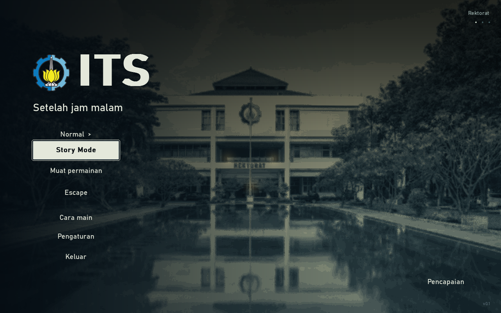

# Setelah Jam Malam — 0.1

Game horor top-down 2D berlatar interpretasi fiksi kampus ITS. Arga menerima pesan dari ponsel Nara yang tertinggal. Jelajahi kampus, baca bukti, selesaikan puzzle, dan cari jalan pulang bersama Nara.



## Mainkan

**Windows x64:** ekstrak `dist/SetelahJamMalam-Windows-x64.zip`, lalu buka `SetelahJamMalam.exe`. Paket portable berjalan offline tanpa Python. Dari folder proyek, `Jalankan.bat` memilih executable jika tersedia, lalu menggunakan source sebagai fallback.

- **Cerita:** tiga bab, 25 tahap, lima cutscene, kampus terbuka serta interior bertingkat. Tiga slot manual dan autosave menyimpan perjalanan.
- **Escape:** 30 area dengan seed acak dan optimasi Simulated Annealing. Temukan dua sekring, aktifkan panel, lalu lewati pintu keluar.
- Tiga monster dengan sensor berbeda, noise berdasarkan tindakan/material, HP, stamina, senter, tujuh perlengkapan, tas 12 ruang, dan 15 pencapaian lokal.
- Kamera mengikuti pemain; tujuan serta interaksi kontekstual ditampilkan pada layar. Dialog Arga/Nara memakai potret, teks bertahap, dan nada orisinal.

Mulai dari **Easy**. Buka **Cara main** untuk petunjuk lengkap.

## Kontrol

| Tombol | Tindakan |
| --- | --- |
| WASD / panah | Bergerak |
| Mouse | Arah senter dan lemparan |
| Shift / Ctrl | Lari / berjalan pelan |
| E | Interaksi, pintu, tangga; tahan pada panel tertentu |
| F / Q / M | Senter / lempar botol / peta |
| B atau Tab / J | Tas / catatan cerita |
| 1–4 | P3K, minuman energi, alarm, lampu kimia |
| E / Enter / Space saat dialog | Tampilkan sisa teks, lalu lanjut |
| F5 / F9 | Simpan / muat cerita |
| Esc / F11 | Jeda / ganti layar penuh |
| Enter saat cutscene | Lewati; opsi mouse tersedia di menu jeda |

Panduan tas, puzzle, save, dan pemulihan error: [panduan pemain](docs/PLAYER_GUIDE.md).

## Jalankan dari source

Gunakan Python **3.12** dan PowerShell di folder proyek. Versi yang dipakai untuk rilis: Python 3.12.10 dan pygame-ce 2.5.8.

```powershell
python -m venv .venv
.\.venv\Scripts\python.exe -m pip install -r requirements.txt
.\.venv\Scripts\python.exe main.py
```

Untuk pengembangan dan build:

```powershell
.\.venv\Scripts\python.exe -m pip install -r requirements-dev.txt
.\.venv\Scripts\python.exe -m unittest discover -s tests
.\.venv\Scripts\python.exe tools/audit_assets.py
.\Build.bat
```

`horror/version.py` menjadi sumber nomor rilis **0.1**, termasuk metadata Windows **0.1.0.0**. Format save tetap **7**, dengan pembaca save 1–7. Data pengguna berada di `%APPDATA%/ITS-Horror-Game/`; perapian source/build tidak menghapus progres.

## Dokumentasi

- [Indeks dokumentasi](docs/README.md) · [Perubahan rilis](CHANGELOG.md)
- [Struktur kode](docs/ARCHITECTURE.md) · [Panduan pengembangan](CONTRIBUTING.md)
- [Desain permainan](docs/GAME_PLAN.md) · [Algoritma](docs/ALGORITHMS.md)
- [Cerita dan save](docs/STORY_MODE.md) · [Tas dan pencapaian](docs/INVENTORY.md)
- [Aset dan audit](docs/ASSETS.md) · [Acuan ITS](docs/ITS_REFERENCES.md)
- [Verifikasi rilis](docs/QA.md) · [Kredit pihak ketiga](THIRD_PARTY_NOTICES.md)

Bangunan, skala, interior, dan cerita diadaptasi untuk permainan; proyek ini bukan produk resmi ITS. Foto dan lambang ITS memiliki kredit tersendiri dan bukan bagian dari aset CC0. Lisensi kode utama belum ditetapkan; lisensi masing-masing komponen pihak ketiga tetap berlaku.
