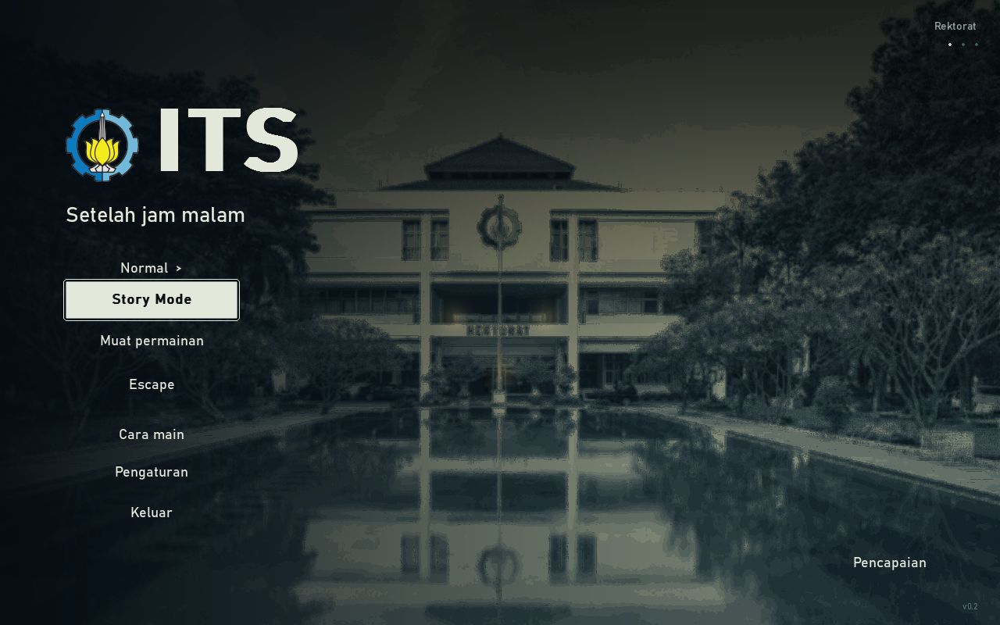

# Setelah Jam Malam v0.2

Game horor top-down 2D berlatar interpretasi fiksi kampus ITS. Arga menerima pesan dari ponsel Nara yang tertinggal. Jelajahi kampus, baca bukti, selesaikan puzzle, dan cari jalan pulang bersama Nara.

## Video

### Trailer gameplay · 0:32

https://github.com/user-attachments/assets/afbc5473-9994-4749-ab8a-cd5a05896e42

### Animasi AI monster · 2:21

Visualisasi Hill Climbing dan Simulated Annealing untuk navigasi monster, dengan perbandingan terhadap A*.

https://github.com/user-attachments/assets/c89be26c-f89e-4932-83b8-1462d44056c5

## Baru di v0.2

Kandidat v0.2 disiapkan pada branch `v0.2` untuk integrasi ke `beta`. [Catatan v0.2](docs/RELEASE_NOTES.md) memuat perubahan, kompatibilitas, dan batas pengujian; [presentasi v0.2](docs/presentations/ETS_KKA_Kelompok_2_ITS_Horror_v0.2.pptx) tersedia sebagai PowerPoint yang dapat diedit.



- Monster memakai Hill Climbing + Simulated Annealing dengan sensor berbasis bukti, profil Easy/Normal/Hard, dan cue sebelum serangan. A* tetap dipakai untuk petunjuk, pendamping, dan bot penguji.
- Bukaan pintu dan interaksi E diperbaiki; tangga berpasangan, courtyard, dan atap Informatika lebih konsisten.
- Pertemuan perpustakaan mempunyai antisipasi, reveal, jeda reaksi, dan fase kejar. Adegan kematian Story/Escape dan kemenangan Escape tampil sebelum hasil.
- Atmosfer menambah variasi permukaan, rekaman radio/buku, detak, napas, grain dan pencahayaan dengan prioritas cue serta pengaturan reduced motion.
- Waypoint memilih rute terjangkau; HUD, prompt pintu/tangga, dan peta M memakai langkah berikut yang sama. Wave Map 3D melalui V memperlihatkan local search monster.
- Launcher shell mendukung source Linux/macOS dan Git Bash. Minimap masih prototipe evaluasi terpisah, belum diaktifkan pada game utama.

## Mainkan

**Windows x64:** ekstrak `dist/SetelahJamMalam-Windows-x64.zip`, lalu buka `SetelahJamMalam.exe`. Paket portable berjalan offline tanpa Python. Dari folder proyek, `Jalankan.bat` menjalankan executable jika tersedia, lalu menggunakan source sebagai fallback.

**Linux/macOS:** jalankan `./Jalankan.sh` untuk menyiapkan environment Python dan memainkan game dari source. `Build.sh` hanya mendukung Windows karena pipeline rilis menghasilkan executable `.exe`.

Pasang Python 3.12 dengan modul `venv` terlebih dahulu (`python3` di Linux/macOS, `python` di Windows/Git Bash). Script meneruskan argumen game, misalnya `./Jalankan.sh --story` atau `./Jalankan.sh --headless --frames 10 --data-dir build/dev-profile`. Di Git Bash, launcher memakai `.venv/Scripts/python.exe`; di Linux/macOS memakai `.venv/bin/python`. Jika `.exe` tersedia, Windows menjalankannya langsung dan Linux/macOS memakai Wine bila terpasang.

- **Cerita:** tiga bab, 25 tahap, lima cutscene, kampus terbuka serta interior bertingkat. Tiga slot manual dan autosave menyimpan perjalanan.
- **Escape:** 30 area dengan seed acak dan optimasi Simulated Annealing. Temukan dua sekring, aktifkan panel, lalu lewati pintu keluar.
- Tiga monster dengan sensor berbeda dan navigasi Hill Climbing + Simulated Annealing, noise berdasarkan tindakan/material, HP, stamina, senter, tujuh perlengkapan, tas 12 ruang, dan 15 pencapaian lokal.
- Kamera mengikuti pemain; tujuan serta interaksi kontekstual ditampilkan pada layar. Dialog Arga/Nara memakai potret, teks bertahap, dan nada orisinal.

Mulai dari **Easy**. Buka **Cara main** untuk petunjuk lengkap.

## Kontrol

| Tombol | Tindakan |
| --- | --- |
| WASD / panah | Bergerak |
| Mouse | Arah senter dan lemparan |
| Shift / Ctrl | Lari / berjalan pelan |
| E | Interaksi, pintu, tangga; tahan pada panel tertentu |
| F / Q / M | Senter / lempar botol / peta |
| V | Tampilan split-screen 3D Wave Map |
| B atau Tab / J | Tas / catatan cerita |
| 1, 2, 3, 4 | P3K, minuman energi, alarm, lampu kimia |
| E / Enter / Space saat dialog | Tampilkan sisa teks, lalu lanjut |
| F5 / F9 | Simpan / muat cerita |
| Esc / F11 | Jeda / ganti layar penuh |
| Enter saat cutscene | Lewati; opsi mouse tersedia di menu jeda |

Panduan tas, puzzle, save, dan pemulihan error: [panduan pemain](docs/PLAYER_GUIDE.md).

## Jalankan dari source

Gunakan Python **3.12** dan PowerShell di folder proyek. Versi yang dipakai untuk rilis: Python 3.12.10 dan pygame-ce 2.5.8.

```powershell
python -m venv .venv
.\.venv\Scripts\python.exe -m pip install -r requirements.txt
.\.venv\Scripts\python.exe main.py
```

Untuk pengembangan dan build:

```powershell
.\.venv\Scripts\python.exe -m pip install -r requirements-dev.txt
.\.venv\Scripts\python.exe -m unittest discover -s tests
.\.venv\Scripts\python.exe tools/audit_assets.py
.\Build.bat
```

Di Windows dengan Git Bash, `./Build.sh` juga dapat digunakan.

`horror/version.py` menjadi sumber nomor rilis **0.2**, termasuk metadata Windows **0.2.0.0**. Format save tetap **7**, dengan pembaca save versi 1 sampai 7. Data pengguna berada di `%APPDATA%/ITS-Horror-Game/`; pembaruan game tidak menghapus progres. Ekstrak paket v0.2 ke folder baru dan pertahankan folder data pengguna; panduan lengkap ada pada [catatan pembaruan](docs/RELEASE_NOTES.md).

## Dokumentasi

- [Indeks dokumentasi](docs/README.md) · [Perubahan rilis](CHANGELOG.md)
- [Catatan v0.2 dan upgrade](docs/RELEASE_NOTES.md) · [Panduan presentasi](docs/PRESENTATION.md)
- [Struktur kode](docs/ARCHITECTURE.md) · [Panduan pengembangan](CONTRIBUTING.md)
- [Desain permainan](docs/GAME_PLAN.md) · [Algoritma](docs/ALGORITHMS.md)
- [Cerita dan save](docs/STORY_MODE.md) · [Tas dan pencapaian](docs/INVENTORY.md)
- [Aset dan audit](docs/ASSETS.md) · [Acuan ITS](docs/ITS_REFERENCES.md)
- [Verifikasi rilis](docs/QA.md) · [Kredit pihak ketiga](THIRD_PARTY_NOTICES.md)

## Lisensi dan kredit aset

| Aset | Lisensi dan kredit |
| --- | --- |
| Tile lantai dan furnitur | **CC0 1.0**, Top-down Shooter Pack karya Kenney. [Teks lisensi](assets/kenney/License.txt) |
| Efek langkah, pintu, dan foley | **CC0 1.0**, Impact Sounds dan RPG Audio karya Kenney. [Lisensi Impact Sounds](assets/audio/impact-License.txt) · [Lisensi RPG Audio](assets/audio/rpg-License.txt) |
| Musik, ambience, dan suara monster, radio, serta buku | **CC0 1.0**, dari para kreator OpenGameArt. [Kreator, judul, dan tautan sumber setiap rekaman](assets/story_audio/CREDITS.txt) |
| Foto Rektorat, Tower 2, dan Informatika serta lambang ITS | Media Institut Teknologi Sepuluh Nopember dengan kredit terpisah dari aset CC0. [Publikasi asal dan panduan identitas visual ITS](docs/ITS_REFERENCES.md) |
| Karakter, monster, antarmuka, dan dekorasi prosedural | Dibuat untuk proyek ini. [Rincian aset](docs/ASSETS.md) |

Trailer menggunakan *Night Shift* karya iamoneabe, *Chase - Diamond Dust* karya NBJDLukasAbsolute, dan klip radio karya Kresiek The Furry. [Kredit audio lengkap](assets/story_audio/CREDITS.txt)

Lisensi kode utama belum ditetapkan. Lisensi masing-masing komponen pihak ketiga tetap berlaku. Bangunan, skala, interior, dan cerita diadaptasi untuk permainan. Proyek ini bukan produk resmi ITS. [Pemberitahuan pihak ketiga](THIRD_PARTY_NOTICES.md)
