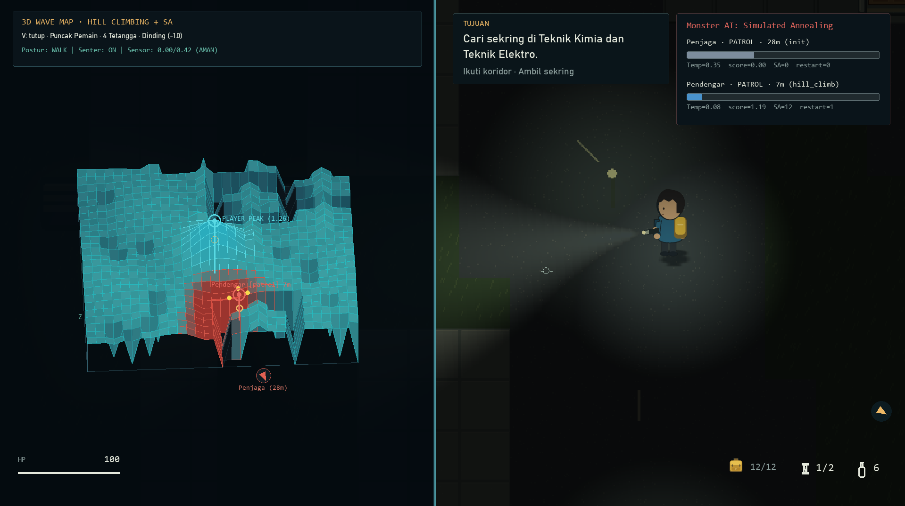

# Algoritma

## Local search untuk Escape

Simulated Annealing mengoptimalkan kandidat `S = (f1, f2, m1, m2, m3, L)`: dua ruang sekring, tiga ruang spawn monster, dan enam edge tambahan pada graph 6×5 area. Randomized DFS menghasilkan spanning tree `T`; kandidat memakai `G = T ∪ L`, sehingga pergantian edge tambahan tetap mempertahankan keterhubungan.

Hard constraints menolak sasaran/monster duplikat, lokasi terlarang, monster terlalu dekat spawn, dan edge tambahan duplikat. Biaya menggabungkan jarak rute tujuan serta pemisahan ancaman:

```text
r = min(d(spawn,f1)+d(f1,f2)+d(f2,panel),
        d(spawn,f2)+d(f2,f1)+d(f1,panel)) + d(panel,exit)
cost = 1.4 * abs(r - 19)
     + 2.0 * max(0, 5 - d(f1,f2))
     + 0.6 * sum(max(0, 5 - d(spawn,m)))
     + 0.4 * (max(0, 2 - d(m1,m2)) + max(0, 2 - d(m2,m3)))
```

Jarak adalah edge antararea. Neighbor mengubah satu variabel atau edge tambahan. Perbaikan diterima; kenaikan biaya `Δ` diterima dengan probabilitas `exp(-Δ/T)`. Temperatur awal 2,5 menurun ×0,985 dengan minimum 0,025 selama 420 iterasi. Kandidat terbaik disimpan terpisah. Seed menghasilkan layout awal yang dapat diulang; aksi dan timing pemain tetap memengaruhi perjalanan.

Biaya ini parameter desain, bukan pengukuran langsung keseruan. Story memakai map tetap; Simulated Annealing tidak mengacak progres cerita.

## Pengejaran dan eksplorasi monster (Hill Climbing + Simulated Annealing)

Pergerakan seluruh monster (`Penjaga`, `Pendengar`, `Penyergap`) di mode Story maupun Escape ditentukan oleh **Hill Climbing (HC) + Simulated Annealing (SA)** pada lanskap skor diskret 4-arah di atas grid lantai valid (`walkable(cell, True)`). Monster tidak menggunakan A*, BFS, atau Dijkstra sebagai perencana rute tersembunyi.

### Lanskap skor dan tetangga legal

Setiap layout membangun peta dasar 3D statis `base_hill` secara deterministik dari seed (`ensure_hill_map`):
- **Dinding dan rintangan padat**: tinggi tetap `-1.0` (dan skor evaluasi `-∞` sehingga tidak pernah dipilih sebagai langkah).
- **Grid lantai valid (termasuk pintu)**: tinggi mulus `B(x, y)` dari kombinasi 4 puncak Gaussian statis yang ambigu, gelombang sinusoidal dua dimensi beramplitudo kecil, kontur koridor/pintu untuk menjaga konektivitas lokal antarruang, serta variasi halus per sesi (`hill_phase`).

Pada setiap keputusan langkah (`_local_search_step`), monster mengevaluasi tetangga 4-arah legal dengan batas iterasi tetap (`LOCAL_SEARCH_BUDGET = 8`) menggunakan fungsi skor:

```text
score(x, y) = B(x, y)
            + P_player(x, y)
            + G_target(x, y)
            - R_tabu(x, y)
            + M_heading(x, y)
```

- `P_player(x, y)`: puncak Gaussian sempit dan curam (`PLAYER_PEAK_AMP = 1.85`, `PLAYER_PEAK_SIGMA = 3.6`, ambang deteksi `SIGNATURE_THRESHOLD = 0.42`) yang berpusat di sekitar pemain **hanya** jika terdeteksi oleh aturan sensor eksplisit per jenis monster (`SENSOR_PROFILES`), postur (`sprint`, `walk`, `crouch`), senter, efek `quiet`, serta oklusi dinding (`line_clear`). Saat pemain di luar jangkauan sensor atau masa tenggang (`grace`), `P_player(x, y) = 0` sehingga tidak ada kebocoran koordinat global.
- `G_target(x, y)`: tarikan bukit bukti terakhir (suara/jejak terakhir) atau target lantai eksplorasi (`explore_target`), dengan penalti pintu tertutup ringan (`0.05`).
- `R_tabu(x, y)`: depresi jejak langkah Gaussian lokal (`visit_heat`), memori pintu antarruang (`zone_heat`), dan penalti balik arah langsung (`visited_cells`) yang meredam osilasi bolak-balik.
- `M_heading(x, y)`: bias momentum arah hadap (`0.004 * dot(step, facing)`).

### Siklus deteksi, pengejaran, jadwal temperatur, dan pemulihan macet

1. **Deteksi & Pengejaran (Hill Climbing)**:
   Saat `sees_player` atau `neighborhood_signature >= SIGNATURE_THRESHOLD`, monster membatalkan target eksplorasi acak (`explore_target = None`), mengunci bukit puncak pemain, mendinginkan temperatur (`T <- max(TEMP_MIN, T * COOLING_RATE)` dengan `COOLING_RATE = 0.88`, `TEMP_MIN = 0.08`), dan mendaki gradien tercuram (`hill_climb`).
2. **Kehilangan Jejak & Deteksi Macet (Local Optimum / Plateau / Osilasi)**:
   Ketika pemain menjauh hingga puncak `P_player` turun di bawah `SIGNATURE_THRESHOLD`, monster beralih ke `search` menuju bukti terakhir. Saat mencapai puncak bukti yang telah menghilang (`delta_best < -PLATEAU_EPS`), mendaki area datar (`|delta_best| <= PLATEAU_EPS`, `PLATEAU_EPS = 0.012`), atau mengarah kembali ke sel sebelumnya (`oscillation`), penghitung `stall_steps` bertambah dan temperatur dipanaskan ulang (`T <- min(TEMP_MAX, max(T * REHEAT_RATE, TEMP_REHEAT))` dengan `TEMP_REHEAT = 0.82`, `REHEAT_RATE = 1.65`, `TEMP_MAX = 1.0`).
3. **Eksplorasi SA & Target Lantai Acak**:
   Pada kondisi macet atau temperatur tinggi, kandidat tetangga non-balik-arah diuji secara probabilistik: langkah menurun (`delta < 0`) diterima dengan peluang Metropolis `exp(delta / T)` (`sa_downhill`). Jika `stall_steps >= STALL_LIMIT` (`4`) atau monster tiba di puncak lokal saat patroli/pencarian, monster melakukan restart lokal (`restart_random_floor`): memilih sel lantai valid secara acak berbobot (`_random_floor_target`) sebagai `explore_target`. Selama menuju `explore_target`, monster terus memindai `neighborhood_signature`; begitu puncak pemain kembali melampaui `SIGNATURE_THRESHOLD`, `explore_target` langsung dibatalkan dan pengejaran dilanjutkan.
4. **Batas Local Search vs Perencana Global**:
   Karena HC+SA hanya mengevaluasi gradien lokal tanpa peta rute global, penghalang dinding multi-ruang pada struktur pohon rentang (misalnya pada `seed 3` di mana ruang `11` dan ruang exit `5` dipisahkan dinding horizontal lima ruang yang hanya terhubung melalui memutar ke sisi barat) tidak dapat ditembus secara langsung seperti A*. Pada kasus tersebut, mekanisme reheat SA dan `restart_random_floor` memastikan monster tidak membeku atau berosilasi permanen, melainkan berpindah mengeksplorasi ruang lantai valid lainnya. Jejak keputusan disimpan secara deterministik pada `monster.trace` dan dapat diamati secara langsung melalui peta gelombang 3D (`V`) maupun overlay debug (`F3`).



## Jalur bantu, noise dan persepsi

- **A* (`Layout.path`)**: memakai grid empat arah dan heuristik Manhattan (lantai berbiaya 1, pintu tertutup berbiaya 2). Dipakai **khusus** untuk petunjuk langkah HUD (`guidance.py`), pergerakan pendamping Nara (`story.py`), serta bot penguji otomatis (`tools/` dan `tests/`), **bukan** untuk monster.
- **BFS (`Layout.reachable`)**: memvalidasi keterjangkauan sasaran, sekring, panel, dan exit saat pembangkitan map. Validator tidak memodelkan puzzle cerita; progresi diuji oleh campaign driver terpisah.
- **Dijkstra (`Layout.sound_field`)**: merambatkan suara dari sumber `emit_noise` dengan biaya lantai 1 dan pintu tertutup 3,5 hingga budget habis. Dinding/furnitur padat menghalangi model akustik ini. Difficulty dan jenis monster mengalikan budget. Playback audio terpisah: mute tidak mengubah pendengaran AI.

Collision lingkaran terhadap AABB dengan substep memakai grid yang sama. Pintu tertutup dibuka monster saat didekati (`toggle_door`) dan perpindahan lantai Story (`followers`) tetap mempertahankan aturan tanpa teleportasi. Penyergap mengunci arah ketika wind-up. Tidak ada koordinat pemain tersembunyi yang disuntikkan ke target monster.

## Kamera, cahaya dan UI

Kamera mengikuti target pemain dengan smoothing `1 - exp(-10*dt)` lalu dijepit pada batas map. Viewport mengikuti rasio layar dengan zoom dekat. Mouse dikonversi ke koordinat dunia melalui zoom dan kamera. Cahaya radial/cone memakai raycast dengan penyempurnaan titik tumbukan. Dunia dikomposisikan terlebih dahulu; teks penting, objek dan karakter ditampilkan pada piksel native.

HUD memisahkan tujuan akhir dari tindakan berikutnya. `guidance.py` mencari langkah yang dapat dijangkau, pintu keluar atau tangga; petunjuk tidak memberikan jawaban puzzle. Cache rute bukan bagian save. Teks dialog muncul bertahap, memakai jeda tanda baca dan pulse suara tiap beberapa karakter; narasi/dokumen hening.

## Persistensi

Save schema 7 menyimpan progres, kondisi pemain, level, pintu, item, puzzle, monster, pendamping dan presentasi aktif. Write atomik serta backup menjaga save terakhir yang valid. Restore menerima schema versi 1 sampai 7 dan memigrasikan interior Informatika lama. Versi produk 0.1 terpisah dari schema tersebut.

## Bacaan konsep

- [Poole & Mackworth, local search dan Simulated Annealing](https://artint.info/3e/html/ArtInt3e.Ch4.S6.html)
- [Shaker, Togelius & Nelson, Procedural Content Generation in Games](https://www.pcgbook.com/)
- [Red Blob Games, A*](https://www.redblobgames.com/pathfinding/a-star/introduction.html)
- [Michael Booth, The AI Systems of Left 4 Dead](https://cdn.fastly.steamstatic.com/apps/valve/2009/ai_systems_of_l4d_mike_booth.pdf) menjadi acuan variasi intensitas. Game ini belum memiliki director adaptif global.

Implementasi berada di `horror/world.py`, `simulation.py`, `guidance.py`, dan modul rendering. [Arsitektur](ARCHITECTURE.md) · [verifikasi](QA.md).
